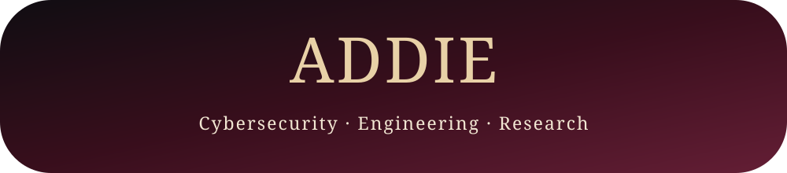
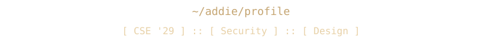
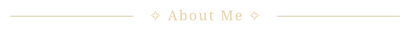
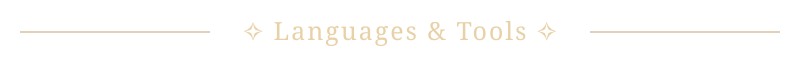
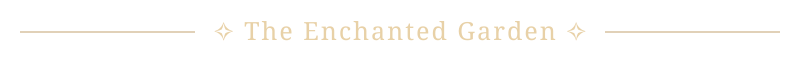

<!-- Main banner -->
<p align="center">
    
</p>

<!-- Animated typing effect -->
<p align="center">
    
</p>

<!-- Social badges -->
<p align="center">
  <a href="www.linkedin.com/in/aditi-kulkarni-881322212">
    
  </a>
  <a href="mailto:kulkaditi07@gmail.com">
    
  </a>
  <a href="https://docs.google.com/document/d/1r2W6undrikRgDwEP3FF4aznHkPK5Bi3XAYKaiGJ0N5k/edit?usp=sharing">
    
  </a>
</p>

<!-- Terminal identity -->
<p align="center">
  
</p>

<!-- About Me -->
<p align="center">
  
</p>

```cpp
#include <string>
using namespace std;

class Addie {
public:
    string degree = "Computer Science Engineering";
    string specialization = "Cybersecurity";
    int graduation = 2029;

    string roles[3] = {
        "Founder",
        "Creative Designer",
        "Aspiring Security Engineer"
    };

    string interests[5] = {
        "Application Security",
        "Full Stack Development",
        "Research and Development",
        "Visual Design"
    };

    string currentlyLearning[4] = {
        "Capturing the Flags (CTF'S)",
        "Network Security",
        "UI/UX designing",
        "Web Security"
    };

    string goal = "Engineering with Security in Mind";
};
```
<!-- Languages and Tools -->
<p align="center">
  
</p>

<p align="center">
  
</p>

<!-- The Enchanted Garden -->
<p align="center">
  
</p>

<p align="center">
  
</p>

<p align="center">
  <i>A little world that grows with every contribution.</i>
</p>